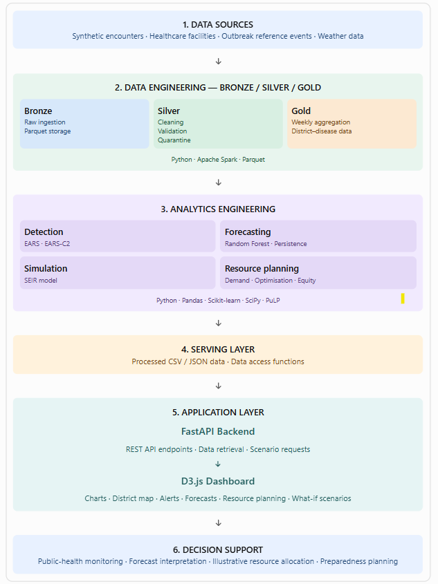
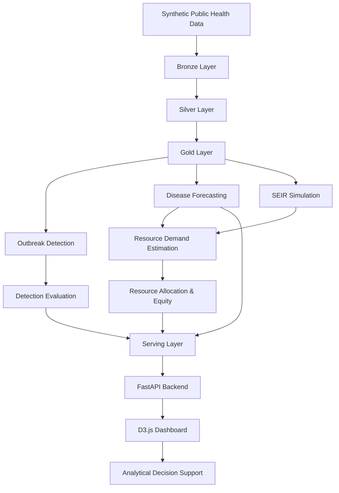
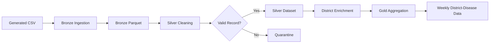
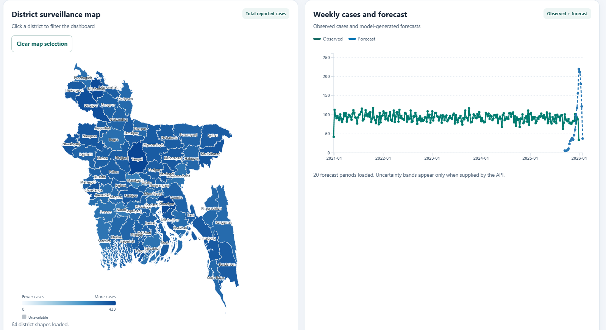
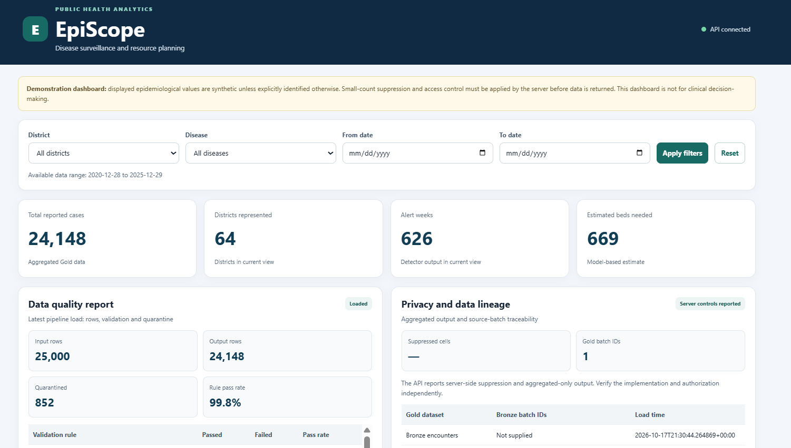

# 🏥 EpiScope
### Public Health Surveillance, Outbreak Detection & Resource Planning

<p align="center">
  <strong>Turning public health data into actionable surveillance insights.</strong>
</p>

<p align="center">
  
  
  
  
  
</p>

---

## 📌 Table of Contents

- [About the Project](#-about-the-project)
- [Project Objectives](#-project-objectives)
- [System Architecture](#-system-architecture)
- [Technologies Used](#-technologies-used)
- [Project Structure](#-project-structure)
- [Key Features](#-key-features)
- [Data Engineering Pipeline](#-data-engineering-pipeline)
- [Analytics Modules](#-analytics-modules)
- [Dashboard](#-dashboard)
- [Installation and Execution](#-installation-and-execution)
- [Team Members](#-team-members-and-contributions)
- [Data Quality and Reliability](#-data-quality-and-reliability)
- [Limitations and Important Notes](#-limitations-and-important-notes)
- [Presentation](#-video-presentation)
- [License](#-license)

---

## 🌍 About the Project

**EpiScope** is a public-health surveillance and analytics prototype designed to process disease surveillance data, monitor disease trends, identify potential outbreak signals, and explore healthcare resource planning across districts in Bangladesh.

The project combines a layered Big Data Engineering pipeline with statistical outbreak detection, forecasting, resource-demand estimation, and an interactive dashboard.

The system transforms synthetic public-health data into structured analytical outputs that can be explored through charts, maps, alerts, and planning scenarios.

> ⚠️ EpiScope is an academic prototype using synthetic data and illustrative planning assumptions. It is not a live disease surveillance service or a clinical decision-making system.

---

## 🎯 Project Objectives

| Objective | Description |
|---|---|
| Data engineering | Build a reproducible Bronze-Silver-Gold processing pipeline. |
| Data quality | Clean, validate, enrich, and quarantine invalid records. |
| Data aggregation | Aggregate cases by district, disease, and week. |
| Outbreak detection | Implement Rolling Z-score and EARS-C2 methods. |
| Detection evaluation | Evaluate sensitivity, precision, false alerts, and detection delay. |
| Forecasting | Estimate future disease activity using forecasting models. |
| Resource planning | Convert forecast cases into illustrative resource requirements. |
| Visualization | Present trends, alerts, and district-level statistics through a dashboard. |

---

## 🏗️ System Architecture

The architecture follows an end-to-end data-to-decision workflow.

**[View System Architecture Diagram](docs/System_arcitecture.png)**

<p align="center">
  <a href="docs/System_arcitecture.png">
    
  </a>
</p>

### Architecture workflow



### Architecture layers

<details>
<summary>🥉 Bronze Layer — Raw Data Ingestion</summary>

- Ingests generated encounter records.
- Stores raw records in Parquet format.
- Maintains ingestion metadata and batch information.
- Provides the initial data lake layer.

</details>

<details>
<summary>🥈 Silver Layer — Cleaning and Validation</summary>

- Validates required fields and data types.
- Handles duplicate records.
- Enriches district information.
- Separates invalid records into quarantine.
- Applies configured privacy transformations.

</details>

<details>
<summary>🥇 Gold Layer — Analytical Aggregation</summary>

- Aggregates records by district, disease, and week.
- Produces structured analytical datasets.
- Supports downstream detection, forecasting, and reporting.

</details>

---

## 🛠️ Technologies Used

| Technology | Purpose |
|---|---|
| Python | Data processing and analytics |
| Pandas & NumPy | Data cleaning and statistical calculations |
| PySpark | Distributed data processing and aggregation |
| Parquet | Structured data storage |
| FastAPI | Backend API and data delivery |
| D3.js | Interactive charts and district maps |
| HTML, CSS, JavaScript | Dashboard interface |
| Scikit-learn | Machine learning and forecasting |
| SciPy | Epidemiological simulation |
| PuLP | Resource allocation optimization |
| Git & GitHub | Version control and collaboration |

---

## 📁 Project Structure

```text
```text
EpiScope_BDA/
│
├── analytics/
│   ├── analytics/
│   │   ├── calendar/
│   │   │   ├── outbreak_calendar.py
│   │   │   ├── preparedness_calendar.py
│   │   │   ├── outbreak_calendar.csv
│   │   │   ├── outbreak_by_disease.csv
│   │   │   ├── outbreak_by_district.csv
│   │   │   ├── outbreak_monthly_summary.csv
│   │   │   ├── outbreak_weekly_summary.csv
│   │   │   └── preparedness_calendar.csv
│   │   │
│   │   ├── detection/
│   │   │   ├── ears_alerts.py
│   │   │   ├── ears_c2.py
│   │   │   ├── evaluate_detection.py
│   │   │   ├── alert_evaluation.csv
│   │   │   ├── ears_alerts.csv
│   │   │   ├── ears_c2_alerts.csv
│   │   │   ├── evaluation_metrics.csv
│   │   │   ├── evaluation_results.csv
│   │   │   ├── false_alerts_by_district_year.csv
│   │   │   └── threshold_tradeoff.csv
│   │   │
│   │   ├── forecast/
│   │   │   ├── create_weekly_weather.py
│   │   │   ├── evaluate_forecasts.py
│   │   │   ├── forecast_cases.py
│   │   │   ├── resource_demand.py
│   │   │   ├── seir_model.py
│   │   │   ├── backtest_by_disease.csv
│   │   │   ├── backtest_by_district.csv
│   │   │   ├── backtest_details.csv
│   │   │   ├── backtest_summary.csv
│   │   │   ├── forecasts.csv
│   │   │   ├── resource_demand.csv
│   │   │   ├── resource_demand_by_district.csv
│   │   │   ├── seir_simulation.csv
│   │   │   └── seir_summary.csv
│   │   │
│   │   ├── optimise/
│   │   │   ├── allocation.py
│   │   │   ├── equity_analysis.py
│   │   │   ├── scenario_analysis.py
│   │   │   ├── allocation_results.csv
│   │   │   ├── equity_by_district.csv
│   │   │   ├── equity_by_week.csv
│   │   │   ├── equity_summary.csv
│   │   │   ├── lorenz_curve.csv
│   │   │   ├── scenario_allocation_results.csv
│   │   │   └── scenario_summary.csv
│   │   │
│   │   └── scalability/
│   │       └── run_scalability.py
│   │
│   ├── calendar/
│   │   └── preparedness_calendar.csv
│   │
│   ├── detection/
│   │   ├── alert_evaluation.csv
│   │   ├── ears_alerts.csv
│   │   ├── ears_c2_alerts.csv
│   │   ├── evaluation_metrics.csv
│   │   ├── evaluation_results.csv
│   │   ├── false_alerts_by_district_year.csv
│   │   └── threshold_tradeoff.csv
│   │
│   ├── forecast/
│   │   ├── forecasts.csv
│   │   ├── resource_demand.csv
│   │   └── resource_demand_by_district.csv
│   │
│   └── optimise/
│       ├── allocation_results.csv
│       ├── equity_by_district.csv
│       ├── equity_by_week.csv
│       ├── equity_summary.csv
│       ├── lorenz_curve.csv
│       ├── scenario_allocation_results.csv
│       └── scenario_summary.csv
│
├── api/
│   ├── main.py
│   └── requirements-dashboard.txt
│
├── dashboard/
│   ├── app.js
│   ├── index.html
│   └── styles.css
│
├── data/
│   ├── lake/
│   │   ├── bronze/
│   │   │   └── encounters/
│   │   │
│   │   ├── silver/
│   │   │   ├── encounters/
│   │   │   └── encounters_named/
│   │   │
│   │   └── gold/
│   │       ├── data_quality/
│   │       └── weekly_district_disease/
│   │           ├── year=2020/
│   │           ├── year=2021/
│   │           ├── year=2022/
│   │           ├── year=2023/
│   │           ├── year=2024/
│   │           └── year=2025/
│   │
│   ├── quarantine/
│   │   └── encounters/
│   │
│   ├── raw/
│   │   └── generated/
│   │       ├── encounters.csv
│   │       ├── facilities.csv
│   │       └── ground_truth_outbreaks.csv
│   │
│   ├── reference/
│   │   ├── create_division_mapping.py
│   │   ├── districts.geojson
│   │   ├── district_division_mapping.csv
│   │   └── district_mapping.csv
│   │
│   ├── reports/
│   │   ├── bronze_ingestion.json
│   │   ├── district_mapping.json
│   │   ├── silver_quality.json
│   │   ├── bronze_ingestion/
│   │   ├── full_extraction/
│   │   │   ├── bronze_encounters/
│   │   │   ├── silver_encounters/
│   │   │   ├── silver_encounters_named/
│   │   │   ├── bronze_encounters_null_counts.csv
│   │   │   ├── bronze_encounters_schema.json
│   │   │   ├── existing_csv_inventory.csv
│   │   │   ├── extraction_errors.csv
│   │   │   ├── extraction_summary.json
│   │   │   ├── parquet_layer_inventory.csv
│   │   │   ├── silver_encounters_named_null_counts.csv
│   │   │   ├── silver_encounters_named_schema.json
│   │   │   ├── silver_encounters_null_counts.csv
│   │   │   └── silver_encounters_schema.json
│   │   │
│   │   ├── gold_disease_totals/
│   │   ├── report_metrics/
│   │   │   ├── all_csv_file_inventory.csv
│   │   │   ├── all_report_metrics.csv
│   │   │   └── extraction_errors.csv
│   │   │
│   │   └── scalability/
│   │       ├── scalability_report.json
│   │       ├── scalability_results.csv
│   │       └── scalability_summary.csv
│   │
│   └── weather/
│       ├── weather_daily.csv
│       ├── weather_failures.csv
│       └── weather_weekly.csv
│
├── docs/
│   ├── Dashboard_1.png
│   ├── Dashboard_2.png
│   └── System_arcitecture.png
│
├── generator/
│   ├── create_district_mapping.py
│   ├── download_boundaries.py
│   ├── download_weather.py
│   └── generate_data.py
│
├── logs/
│   └── pipeline_runs/
│       ├── pipeline_20261031T100554_201700Z.log
│       ├── pipeline_20261031T101331_089545Z.log
│       └── pipeline_20261101T054026_328790Z.log
│
├── pipeline/
│   ├── bronze/
│   │   ├── ingest.py
│   │   └── spark_check.py
│   │
│   ├── silver/
│   │   ├── add_district_names.py
│   │   └── clean.py
│   │
│   ├── gold/
│   │   └── aggregate.py
│   │
│   └── run_pipeline.py
│
├── serving/
│   ├── __init__.py
│   └── data_access.py
│
└── tests/
    ├── conftest.py
    └── test_data_quality.py
```
```

<sub>Note: This is a representative structure. Directory names and files may differ between project versions. Confirm the actual repository before publishing.</sub>

---

## ✨ Key Features

<details open>
<summary>📊 Data Engineering</summary>

- Layered Bronze, Silver, and Gold architecture.
- Data validation and cleaning.
- Duplicate handling.
- Invalid-record quarantine.
- District-name enrichment.
- Weekly district-disease aggregation.

</details>

<details>
<summary>🚨 Outbreak Detection</summary>

- Rolling Z-score detection.
- EARS-C2 detection.
- Configurable thresholds.
- Statistical alert generation.
- Detection performance evaluation.

</details>

<details>
<summary>📈 Forecasting and Simulation</summary>

- District-wise disease forecasting.
- Random Forest and persistence fallback.
- Forecast backtesting.
- Exploratory SEIR simulation.
- Resource-demand estimation.

</details>

<details>
<summary>⚖️ Resource Planning</summary>

- Weekly resource allocation.
- Capacity-constrained optimization.
- District-level coverage analysis.
- Equity summaries.
- Scenario comparison.
- Preparedness calendar.

</details>

<details>
<summary>🗺️ Interactive Dashboard</summary>

- Public-health summary indicators.
- Disease trend charts.
- District-level map.
- Outbreak alert tables.
- Forecast visualization.
- Resource-demand summaries.
- Interactive what-if scenario controls.

</details>

---

## 🔄 Data Engineering Pipeline



### Pipeline outputs

| Layer | Main output |
|---|---|
| Bronze | Raw Parquet data |
| Silver | Cleaned and validated records |
| Quarantine | Invalid or rejected records |
| Gold | Weekly district-disease aggregates |
| Reports | Ingestion and data-quality reports |

---

## 🧠 Analytics Modules

| Module | Main purpose | Example output |
|---|---|---|
| `ears_alerts.py` | Rolling Z-score detection | `ears_alerts.csv` |
| `ears_c2.py` | EARS-C2 detection | `ears_c2_alerts.csv` |
| `evaluate_detection.py` | Evaluate detection performance | `evaluation_metrics.csv` |
| `forecast_cases.py` | Forecast future disease cases | `forecasts.csv` |
| `evaluate_forecasts.py` | Evaluate forecast accuracy | Forecast evaluation reports |
| `seir_model.py` | Exploratory epidemiological simulation | SEIR outputs |
| `resource_demand.py` | Estimate illustrative resource needs | `resource_demand.csv` |
| `allocation.py` | Optimize resource allocation | `allocation_results.csv` |
| `equity_analysis.py` | Examine allocation equity | Equity reports |
| `scenario_analysis.py` | Compare capacity scenarios | `scenario_summary.csv` |

### Outbreak detection evaluation

The detection evaluation module examines:

- Sensitivity
- Alert precision
- False-alert weeks
- Detection delay
- Threshold trade-offs

> Outbreak alerts are statistical screening signals. They do not establish that an outbreak has been confirmed.

### Resource-demand assumptions

Resource requirements are estimated using configurable assumptions.

| Resource | Illustrative calculation |
|---|---|
| Beds | Forecast cases × configured bed fraction |
| IV saline | Forecast cases × configured saline units per case |
| ORS | Forecast cases × configured ORS units per case |

The estimates are planning scenarios, not clinical recommendations or actual hospital consumption figures.

---

## 🖥️ Dashboard

The EpiScope dashboard connects analytical outputs to an interactive web interface.

**Dashboard features include:**

- Summary indicators
- Weekly disease trends
- Disease comparisons
- District maps
- Outbreak alerts
- Forecast visualization
- Resource-demand planning
- Allocation and equity analysis
- Preparedness calendar
- What-if scenario planning

### Dashboard preview

<p align="center">
  
  
</p>


---

## ⚙️ Installation and Execution

<details>
<summary><strong>Step 1 — Prerequisites</strong></summary>

Install:

- Python 3.11
- Git
- A supported Windows, Linux, or macOS environment

</details>

<details>
<summary><strong>Step 2 — Clone the repository</strong></summary>

Replace the repository URL with your actual GitHub URL.

```bash
git clone https://github.com/YOUR_USERNAME/EpiScope_BDA.git
cd EpiScope_BDA
```

</details>

<details>
<summary><strong>Step 3 — Create and activate a virtual environment</strong></summary>

**Windows PowerShell**

```powershell
python -m venv .venv311
.\.venv311\Scripts\Activate.ps1
```

**Linux / macOS**

```bash
python3 -m venv .venv311
source .venv311/bin/activate
```

</details>

<details>
<summary><strong>Step 4 — Install dependencies</strong></summary>

```bash
python -m pip install --upgrade pip
pip install -r requirements.txt
```

</details>

<details>
<summary><strong>Step 5 — Run outbreak detection</strong></summary>

```bash
python .\analytics\detection\ears_alerts.py
python .\analytics\detection\ears_c2.py
```

Evaluate the generated alerts:

```bash
python .\analytics\detection\evaluate_detection.py
```

</details>

<details>
<summary><strong>Step 6 — Run forecasting and resource-demand estimation</strong></summary>

Run forecasting first:

```bash
python .\analytics\forecast\forecast_cases.py
```

Then estimate resource demand:

```bash
python .\analytics\forecast\resource_demand.py
```

Run additional allocation and equity modules after their required input files are available:

```bash
python .\analytics\optimise\allocation.py
python .\analytics\optimise\equity_analysis.py
python .\analytics\optimise\scenario_analysis.py
```

</details>

<details>
<summary><strong>Step 7 — Start the API server</strong></summary>

From the project root:

```bash
python -m uvicorn api.main:app --reload --host 127.0.0.1 --port 8000
```

Open the API documentation:

**http://127.0.0.1:8000/docs**

</details>

<details>
<summary><strong>Step 8 — Open the dashboard</strong></summary>

If the FastAPI application serves the dashboard:

**http://127.0.0.1:8000/**

Otherwise, use the static dashboard instructions configured in the repository.

</details>

---

## 👥 Team Members and Contributions

| Team member | Role | Contribution |
|---|---|---|
| Mahitun Nesa Mahi | Data Engineer | Data generation, Spark pipeline, Bronze/Silver/Gold layers, data cleaning, validation, and quality reporting |
| Riya Biswas | Analytics Engineer | Outbreak detection, evaluation, forecasting, resource-demand estimation, and allocation optimization |
| Md Saiful Alam | Visualization Engineer | API integration, D3.js dashboard, charts, maps, usability testing, and project demonstration |

---

## 🧪 Data Quality and Reliability

EpiScope uses data-quality mechanisms to improve the reliability of analytical datasets.

- Required-field validation.
- Duplicate detection.
- Invalid-record quarantine.
- District mapping and enrichment.
- Pipeline execution reports.
- Detection and forecast evaluation outputs.

Data-quality percentages should be calculated from verified input, accepted, and quarantined record counts.

---

## ⚠️ Limitations and Important Notes

1. **Synthetic data:** Results demonstrate the workflow and should not be interpreted as actual public-health conditions in Bangladesh.
2. **Outbreak alerts:** Statistical alerts are screening signals, not confirmed outbreaks.
3. **Forecast uncertainty:** Prediction intervals are unavailable when they are not supplied by the forecasting source.
4. **Resource estimates:** Bed, saline, and ORS requirements depend on illustrative assumptions.
5. **SEIR simulation:** Results depend on simplified model assumptions and should not be treated as calibrated epidemiological forecasts.
6. **Privacy:** Do not publish sensitive or restricted health records, credentials, environment files, or secrets.
7. **Reproducibility:** Generated datasets, model outputs, and execution reports should be documented appropriately.

---

## 🎥 Video Presentation

[▶ Watch the EpiScope Presentation](https://drive.google.com/drive/folders/1JrJz44JdE4_LI_uMwG3jz199aDlA9G6c?usp=sharing)

## 📌 Video Contents

| Timestamp | Topic |
|:---:|---|
| 00:00 | Introduction |
| 00:43 | Problem, Stakeholders and Conflicts |
| 01:34 | System Architecture |
| 02:38 | Data Generation and Bronze Ingestion |
| 04:13 | Silver Layer: Data Quality and Privacy |
| 05:34 | Gold Layer and Pipeline Orchestration |
| 06:50 | Analytics Workflow |
| 07:43 | Outbreak Detection |
| 08:23 | Detection Evaluation |
| 09:30 | Forecasting and Backtesting |
| 10:45 | SEIR, Resource Demand and Allocation |
| 12:40 | Serving Layer and Privacy |
| 14:28 | D3.js Dashboard |
| 17:28 | What-if Panel and Usability Evaluation |
| 18:54 | Recommendations, Ethics and Conclusion |
| 20:09 | Thank You |
